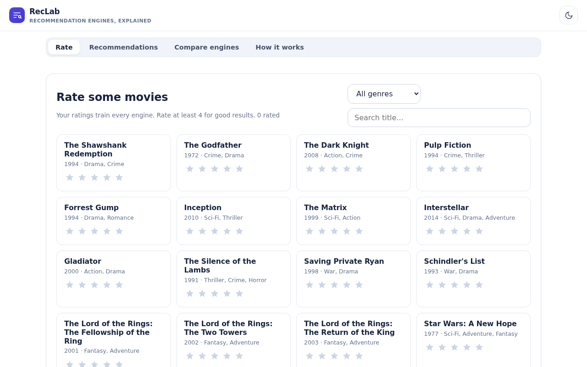
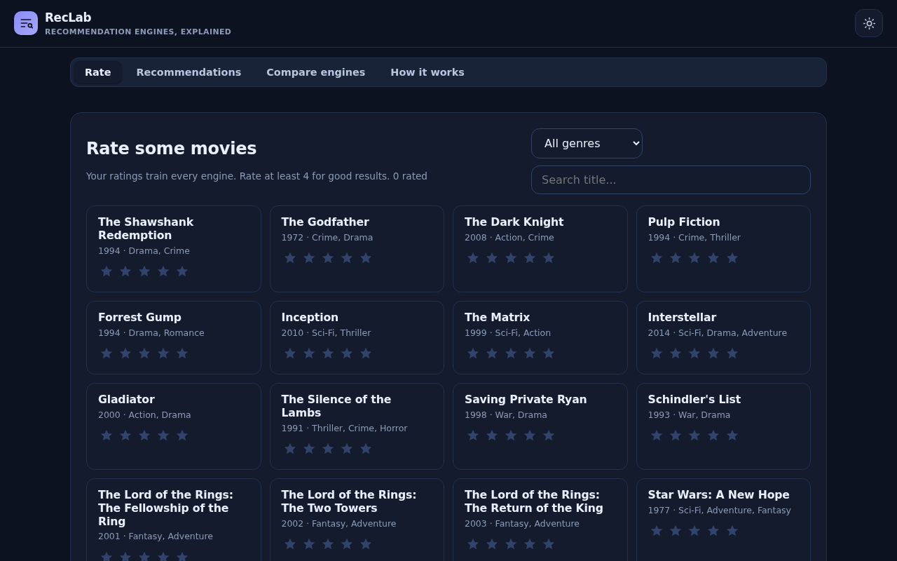
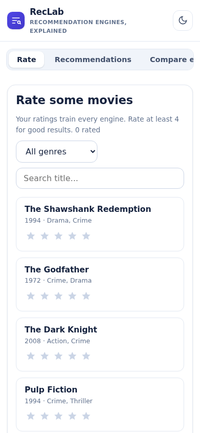

# RecLab - Recommendation Engine Playground

Rate movies and watch three recommendation engines - content-based, collaborative filtering, and a hybrid - explain their picks in real time.

**Live:** https://akash991833.github.io/reco-engine-lab/

## Screenshots

| Desktop (light) | Desktop (dark) | Mobile |
| --- | --- | --- |
|  |  |  |

## Features

- 120-movie catalog with star ratings
- Content-based filtering over genre/era feature vectors
- User-user collaborative filtering (Pearson) against 60 synthetic raters
- Adjustable hybrid weighting, live
- Per-pick explanations ("why this")
- Head-to-head engine comparison
- Dark and light themes, offline PWA

## Tech

Vanilla HTML/CSS/JS - no build step, no dependencies, no tracking. Installable PWA with a service worker, works fully offline. All data stays on your device.

## Run locally

Open `index.html` in a browser, or serve the folder with any static server:

```bash
npx serve .
```

## Honest limits

The community is 60 synthetic personas, so collaborative filtering demonstrates the math rather than a live user base.
